# CSC612M SIMD Vector Dot Product

**Group members:** Jean, JM, Kim
**Course:** CSC612M - Advanced Computer Architecture

<!--
HOW TO USE THIS TEMPLATE
- [FILL: ...]  = something you must write or measure.
- HTML comments like this one are guiding questions. They don't show on GitHub,
  but delete them before submitting anyway.
- Screenshots go in an images/ folder in the repo and are embedded with
   so they appear INLINE (spec: no external links).
-->

## 1. Project Overview

<!--
- What does the program compute, in one sentence?
- Write the formula: Z = sum of A[i] * B[i], i = 0 .. n-1
- Why compare four versions of the same computation? What question is the project answering?
-->

This project is designed to showcase the performance of different SIMD and non SIMD compute kernels that all compute for the vector dot product Z = Σ A[i]·B[i] for i = 0 … n−1.
The dot product formula can also be illustrated as:

$$Z = \sum_{i=0}^{n-1} A_i B_i$$

It compares four implementations using a shared C driver. The C result is the reference for correctness checks.

 As specified by the project specifications, A and B are double-precision vectors, n is an integer and Z is a double. C, x86-64 assembly(non-SIMD), SIMD XMM and SIMD YMM are the 4 versions of the same computation, with the goal of finding out the specific performance levels of each variant and how do they stack up against one another. 


| Kernel | File | Elements per instruction | Author |
| --- | --- | --- | --- |
| C | `dot_product_c.c` | 1 | Kim |
| x86-64 (non-SIMD) | `dot_product_asm.asm` | 1 | Kim |
| SIMD XMM | `dot_product_xmm.asm` | 2 (128-bit / 64-bit double) | [FILL] |
| SIMD YMM | `dot_product_ymm.asm` | 4 (256-bit / 64-bit double) | [FILL] |

## 2. Test Environment

<!--
Without this, nobody can interpret your timings. Find the cache sizes from
Task Manager > Performance > CPU, or the CPU's spec page.
Were ALL timings measured on this machine? If any came from a GitHub Actions
runner, say so here.
-->

| Item | Value |
| --- | --- |
| CPU | intel Core Ultra 5 |
| Cores / threads | 8 |
| L1d / L2 / L3 cache | 832KB/14MB/8MB |
| RAM | LPDDR5 16GB 8500M/T |
| OS | Windows 11 |
| Visual Studio version / toolset | 2026 |
| NASM version | [FILL: run `nasm -v` in a terminal] |

## 3. Program Design and Methodology

### 3.1 Shared interface (`kernels.h`)

<!--
- What is the common signature every kernel uses?
- Under the Windows x64 calling convention, which register holds n, A, B, Z?
- Why does Z come back through a pointer instead of a return value? (Or: why
  is either choice fine, and why did you pick this one?)
- Why freeze the interface before anyone writes a kernel?
-->

The common signature that every kernel variant uses has the parameters: int64_t n, const double* A, const double* B, double* Z. The shared interface will allow for a standard and streamlined way for the kernels to access the memory and minimizing any possible side effects in timing performance.  

These correspond to the registers relevant to the Windows x86-64 calling convention.

```c
void kernel(int64_t n, const double* A, const double* B, double* Z);
```

| Parameter | Register (Windows x64) | Meaning |
| --- | --- | --- |
| `n` | RCX | number of elements |
| `A` | RDX | pointer to first vector |
| `B` | R8 | pointer to second vector |
| `Z` | R9 | pointer to the output scalar |

### 3.2 Input initialization (spec item 5)

<!--
- State the exact formula used for A[i] and B[i].
- Why a fixed formula instead of random numbers?
-->

The exact formula for initializing vectors A and B are:

```text
A[i] = sin(i * 0.001)
B[i] = cos(i * 0.002)
```

The will ensure each kernel's performance will be fairly comparable since the sizes and contents of the vectors should be the same. 

### 3.3 Timing method (spec items 2 and 4)

<!--
- Which timer did you use and why?
- What is INSIDE the timed region? What is deliberately OUTSIDE it?
- Why is there one untimed warm-up call? What happens to the average without it?
- How many timed runs, and how is the reported number computed?
-->

The group opted for QueryPerformanceFrequency and QueryPerformanceCounter as the performance timers for the program. These are included from windows.h and thus are windows native methods to measuring performance metrics. 

`QueryPerformanceCounter` reads a high-resolution hardware counter, and `QueryPerformanceFrequency` gives the number of counter ticks per second. Elapsed time in milliseconds is therefore `(t1 - t0) × 1000 / frequency`. Its resolution is well below a microsecond, which matters because our smallest benchmark (2^20 with the YMM kernel) takes only about half a millisecond. The standard C `clock()` function is far too coarse for that.

#### What is timed

Only the kernel call sits between the two counter reads:

```c
QueryPerformanceCounter(&t0);
fn(n, A, B, Z);              /* the kernel, nothing else */
QueryPerformanceCounter(&t1);
```

Everything else is deliberately outside the timed region:

| Outside the timer | Why |
| --- | --- |
| Allocating A and B (`_aligned_malloc`) | One-time setup cost, not part of the dot product |
| Filling A and B (`init_vectors`) | Computing about 2 × 268 million sin/cos values takes seconds and would dwarf the kernel time |
| Computing the tolerance scale (sum of \|A[i]·B[i]\|) | Only used for the correctness check |
| Comparing results and printing | Done after all timing finishes |
| Computing the statistics (avg, min, max, sd) | Done after all timed runs finish |

All four kernels receive the same A and B arrays for a given n, so every kernel is timed on identical data.

#### Warm-up run

Before the timed runs, each kernel is called once without timing. The first pass over freshly allocated memory triggers page faults, because Windows only maps physical memory to a page the first time it is touched. The first pass also starts with cold caches. Without the warm-up, the first timed run would include these one-time costs and push the average up.

#### Repetitions and reported statistics

Each kernel is timed **30 times** per vector size (spec item 4). Each run's time is stored, and after the 30th run the program computes:

| Statistic | Formula | Use |
| --- | --- | --- |
| Average | sum of run times / 30 | The reported execution time, as the spec requires |
| Min | fastest of the 30 runs | Closest to the kernel's undisturbed speed, since interference only makes runs slower |
| Max | slowest of the 30 runs | Shows whether any run was interrupted |
| Standard deviation | sample SD (divide by 29) | Spread within the 30 runs; SD / average gives the coefficient of variation (CV) |

The tables in Section 8 report the average. Min, max and SD are used in Section 9 to judge whether a difference between two kernels is larger than the measurement noise: if two kernels' averages differ by less than their standard deviations, we treat them as tied.

#### Controlled measurement procedure

Our exploratory runs (Section 10) showed large run-to-run variation on the test laptop. The same kernel at the same size differed by up to about 25% between runs (for example, C at 2^28 measured 1504, 1207 and 1509 ms in three runs). To make the final numbers reliable, every reported run followed the same fixed conditions:

- charger plugged in, Windows power mode set to *Best performance*;
- browsers, chat apps and cloud sync closed;
- laptop on a hard, flat surface;
- program started with **Ctrl+F5** (Start Without Debugging), so no debugger is attached;
- a short pause after closing apps before the first run;
- the same benchmark sizes in every run: 2^20, 2^26 and 2^28.

Each build configuration (Debug and Release) was run **3 times in a row** with nothing changed in between. For each kernel and size, the README tables report the **median** of the three 30-run averages, with the lowest and highest averages as the run-to-run range. The median is used instead of the mean so that a single disturbed run cannot pull the result off. All runs are recorded in our run log spreadsheet, and each reported run has a matching screenshot (see the Appendix).

After the main runs, we added two small sizes that fit in the CPU caches (2^12 and 2^15, Section 8.3). These were measured under the same fixed conditions, but with **one run per build** rather than three, so they are reported as single-run averages.

### 3.4 Vector sizes and memory (spec item 3)

Each vector holds n doubles of 8 bytes, so A and B together need n × 16 bytes.

| n | Elements | Memory for A + B | Result |
| --- | ---: | ---: | --- |
| 2^12 | 4,096 | 64 KiB | Benchmarked (cache-size run) |
| 2^15 | 32,768 | 512 KiB | Benchmarked (cache-size run) |
| 2^20 | 1,048,576 | 16 MiB | Benchmarked |
| 2^26 | 67,108,864 | 1 GiB | Benchmarked |
| 2^28 | 268,435,456 | 4 GiB | Benchmarked; **largest size used** |
| 2^29 | 536,870,912 | 8 GiB | Allocated, but thrashed; not used |
| 2^30 | 1,073,741,824 | 16 GiB | Failed to allocate, or allocated into the page file and never finished; not used |

The test laptop has 16 GB of RAM, part of which is always in use by Windows and other programs.

- **2^30 (16 GiB):** the first attempt failed to allocate. After closing other programs, the allocation succeeded, but the program never finished. `_aligned_malloc` only reserves *virtual* memory, which Windows can back with the page file on the SSD, so the allocation "succeeding" did not mean the data fit in RAM.
- **2^29 (8 GiB):** the allocation succeeded, but Task Manager showed the program thrashing: system memory at 97%, disk at 95%, the program itself writing about 145 MB/s to disk although it never opens a file, only about 3.1 GB of its 8 GB resident in RAM, and only 5.8% CPU use. Timings from such a run would measure the SSD, not memory.
- **2^28 (4 GiB)** fits comfortably in physical RAM, so it is the largest size we report, as the specification allows.

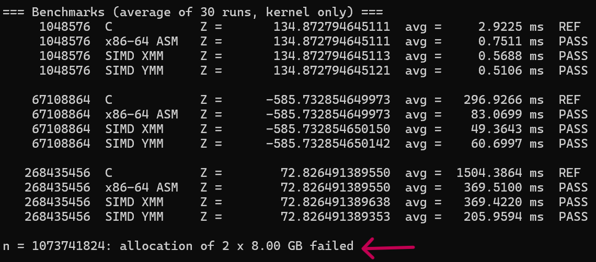

*The first run: the 2^30 allocation (2 × 8 GB) fails.*

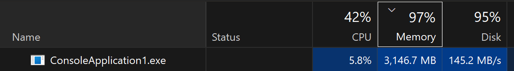

*Task Manager during the 2^29 attempt: memory at 97% and disk at 95%, with the program using about 3.1 GB of RAM, 145 MB/s of disk and 5.8% CPU.*

### 3.5 Correctness method (spec item 6)

<!--
- Why is the C version the reference?
- Why can't you compare with == ?
- What is the tolerance formula, and why scale it by sum|A[i]*B[i]| instead of |Z|?
- Which kernel should match C EXACTLY, and why?
-->

The C kernel is the answer key; the three assembly kernels are checked against it at every size, both in the untimed boundary tests and in the benchmarks.

#### Why C is the reference

The C kernel is the most direct translation of the formula: it adds A[i]·B[i] one element at a time, from i = 0 to n − 1, in the same order you would write the sum by hand. It has no tail handling or lane reduction that could hide a bug, and its machine code comes from the compiler rather than being written by hand. If an assembly kernel disagrees with it, the assembly kernel is the likely culprit.

#### Why the results are not compared with `==`

Floating-point addition is not associative: because every addition rounds its result, `(a + b) + c` can differ from `a + (b + c)` in the last bits. XMM keeps two running sums and YMM keeps four, and they are combined only at the end, so these kernels add the same numbers in a different order than C. Their Z therefore differs from C's in the last few digits even when the code is correct; with `==`, correct SIMD kernels would fail.

#### The tolerance

Tolerance used by the driver:

```text
PASS  if  |Z_kernel - Z_C| <= 1e-9 * sum(|A[i] * B[i]|)
```

The tolerance is scaled by the sum of the absolute products rather than by |Z|. Rounding error builds up in proportion to the size of the numbers being added, not the size of the final answer. With our sin/cos data, large positive and negative products cancel, so Z can be small while the running sums along the way were large (Z = 72.8 at 2^28, for example, after adding 268 million terms). A tolerance based on |Z| would be far too strict and could fail correct results; the sum of |A[i]·B[i]| measures how large the numbers were along the way, which is what the rounding error depends on.

The factor 1e-9 sits between the two things the check must separate:

- **Rounding differences are far smaller.** The SIMD kernels' Z differs from C's by about 2 × 10^-10 or less at every benchmark size, many orders of magnitude below the tolerance.
- **Real bugs are far larger.** For example, if the YMM kernel forgot its tail at n = 1003, it would drop the last term (about −0.35), while the tolerance at that size is about 1.8 × 10^-7, roughly two million times smaller. Any missing, repeated or misread element is caught.

The correctness report at the end of the program's output (Section 6) prints the actual difference and the tolerance for every kernel and size, so the margin is visible.

#### Which kernel should match exactly

The scalar x86-64 kernel performs the same multiply and add, one element at a time, in the same order, with the same 64-bit double rounding as the C loop. Identical operations in an identical order produce identical bits, so its Z matches C's **exactly** (difference 0) at every size. The SIMD kernels match only within the tolerance, for the reason above.

### 3.6 Build configurations

Every result is measured in both Visual Studio configurations, as the specification requires.

| | Debug | Release |
| --- | --- | --- |
| Optimization | Off (`/Od`) | On (`/O2`) |
| Purpose | Easy debugging: every variable lives in memory, code follows the source line by line | Speed: variables kept in registers, redundant work removed |
| `_DEBUG` macro | Defined | Not defined |

The program prints which build it is running (`build: DEBUG` or `build: RELEASE`) by checking `_DEBUG` at compile time.

**What the configuration affects.** Only code that the C compiler generates: the C kernel, and the driver around the kernels (which is not timed). In Debug, the C kernel keeps its running sum in memory and loads and stores it on every iteration; in Release, the sum stays in a register and the loop becomes essentially the same as our hand-written scalar assembly. This is why C is about 3.6–4.9× slower than scalar assembly in Debug, but equal to it in Release (Section 9.1).

**What it cannot affect.** The three assembly kernels. NASM assembles them exactly as written, with the same command in both configurations (`nasm -f win64`), so the instructions that run are identical in Debug and Release. Their measured times agree between builds within run-to-run variation, which confirms this.

**Release C stays scalar.** Even with optimization on, MSVC does not vectorize the C loop by default, because doing so would change the order of the floating-point additions (it would require `/fp:fast`). Release C therefore stays a one-element-at-a-time loop, which is why our SIMD kernels can still beat it.

**Configuration settings must match.** Visual Studio stores project settings separately for each configuration. Our assembly build step was at first set up only for Release, which made the Debug build fail to link (Section 10, problem 1).

## 4. Kernel Implementations

<!-- Short description each. Persons 2 and 3 may write their own subsections. -->

### 4.1 C

File: `dot_product_c.c`

```c
void dot_product_c(int64_t n, const double* A, const double* B, double* Z)
{
    double sum = 0.0;
    for (int64_t i = 0; i < n; i++) {
        sum += A[i] * B[i];
    }
    *Z = sum;
}
```

The kernel is a direct translation of the formula: one loop over i = 0 … n − 1, multiplying A[i] by B[i] and adding the product to a running sum.

- **64-bit loop index.** `i` has the same type as `n` (`int64_t`), so the comparison `i < n` is always between two 64-bit values and the index stays correct at our largest sizes (2^28 elements and beyond).
- **Local accumulator, one store.** The sum is kept in a local `double` and written through `Z` once, after the loop. Writing `*Z += A[i] * B[i]` on every iteration would force a memory store each time in a Debug build and inflate the C timing for no reason. This also mirrors what the assembly kernels do: keep the sum in a register and store it once at the end.
- **No special cases.** The loop handles every n the same way: there is no tail handling, unrolling or lane reduction. For n = 0 the loop simply doesn't run and Z is 0.0, which is the correct answer.

This simplicity is what makes it the answer key (Section 3.5): it adds the elements one at a time, in order, and has no extra code paths where a bug could hide. The C kernel is compiled by MSVC, so it is the only kernel whose speed depends on the build configuration (Section 3.6).

### 4.2 x86-64 (non-SIMD)
<!--
- Which instructions, and how does each map to a line of the C loop?
- Why does "non-SIMD" still use XMM registers?
- How is n <= 0 handled?
-->

| C | x86-64 |
| --- | --- |
| `double sum = 0.0;` | `xorpd xmm0, xmm0` |
| skip if `n <= 0` | `test rcx, rcx` / `jle .done` |
| `A[i] * B[i]` | `movsd xmm1, [rdx]` / `mulsd xmm1, [r8]` |
| `sum += ...` | `addsd xmm0, xmm1` |
| `i++` | `add rdx, 8` / `add r8, 8` / `dec rcx` |
| loop while elements remain | `jnz .loop` |
| `*Z = sum;` | `movsd [r9], xmm0` |

[FILL]

### 4.3 SIMD XMM
<!-- Main loop width, horizontal reduction, tail handling. -->
[FILL]

### 4.4 SIMD YMM
<!--
- Main loop width, reduction of 4 lanes, tail handling, vzeroupper and why.
- Note: vmulpd/vaddpd on YMM are AVX, not AVX2 instructions. What did the
  instructor say about this?
-->
[FILL]

## 5. Program Output and Execution Times (spec item i)

The program's output has three parts:

1. a header line naming the build (`DEBUG` or `RELEASE`) and the number of runs per kernel;
2. the untimed boundary tests (Section 7);
3. the timed benchmarks, showing Z, avg, min, max, SD and PASS/FAIL for every kernel at every size.

It ends with a correctness report grouped by kernel (Section 6). The output is too long for one screen, so each build is shown in two images.

These are example runs of the final program; the tables in Section 8 report the median of three runs, so the numbers here differ slightly from them.

### Debug
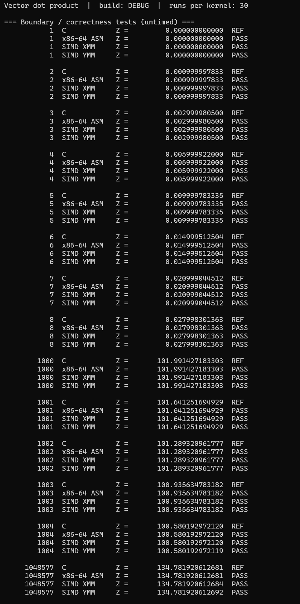

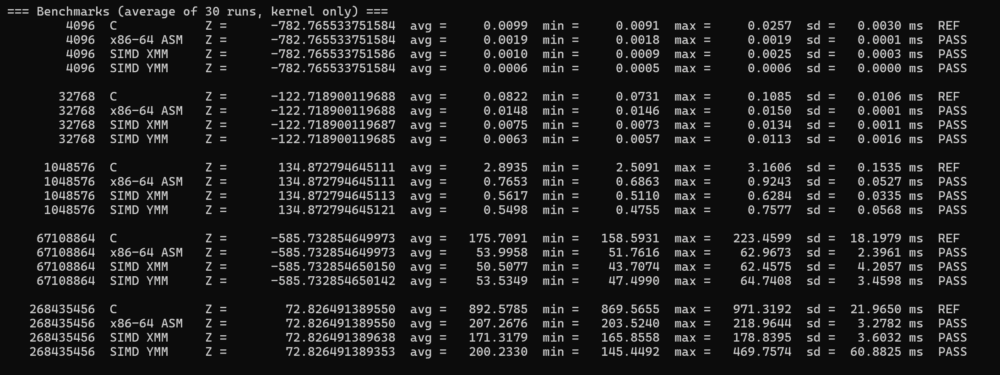

### Release
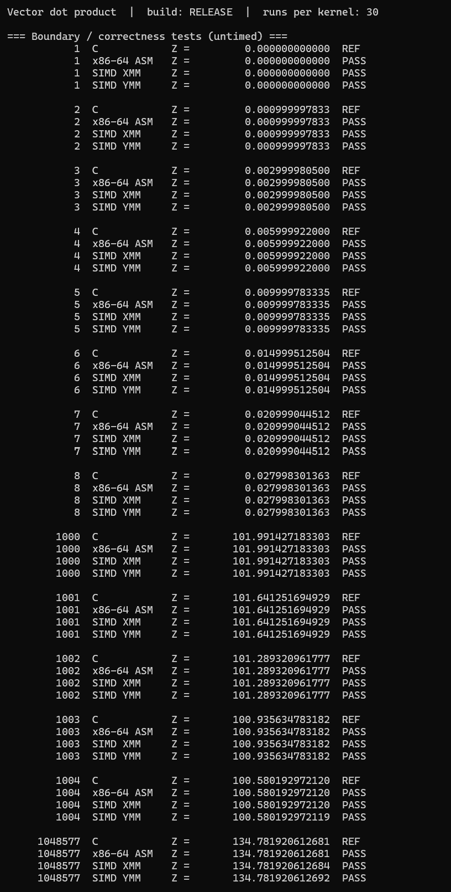

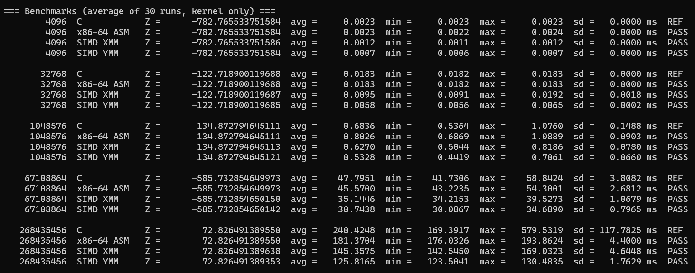

## 6. Correctness Checks (spec items iii-vi)

<!-- Under each screenshot, one or two sentences: does Z match C exactly or within tolerance, and why? -->

After the benchmarks, the program prints a correctness report grouped by kernel. For every benchmark size it shows the kernel's Z, the C reference Z, the difference between them, the allowed tolerance and the verdict. The screenshots below are the four blocks of that report from the Release run.

### 6.1 C
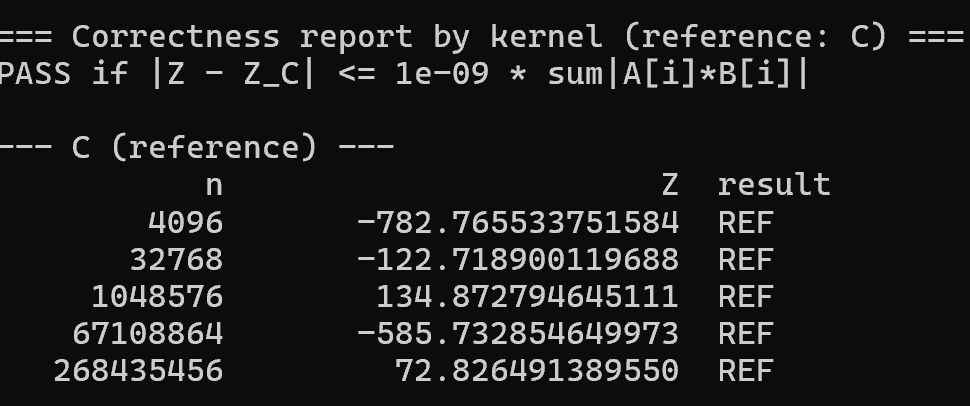
[FILL: caption]

### 6.2 x86-64
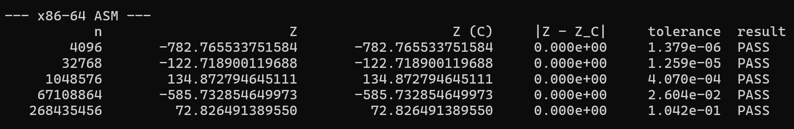
[FILL: caption]

### 6.3 SIMD XMM
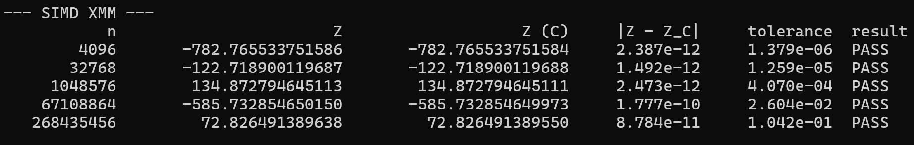
[FILL: caption]

### 6.4 SIMD YMM
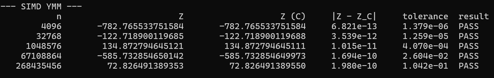
[FILL: caption]

## 7. Boundary Checks (spec items 3a and vii)

<!--
- Which sizes were tested? (Include 1000-1004 from the checklist.)
- What would the output look like if the tail code were missing?
- Why is n = 1 an interesting case for YMM?
-->

Elements handled by the packed main loop vs. the scalar tail:

| n | n mod 2 | XMM main / tail | n mod 4 | YMM main / tail | Result |
| ---: | ---: | --- | ---: | --- | --- |
| 1000 | 0 | 1000 / 0 | 0 | 1000 / 0 | [FILL] |
| 1001 | 1 | 1000 / 1 | 1 | 1000 / 1 | [FILL] |
| 1002 | 0 | 1002 / 0 | 2 | 1000 / 2 | [FILL] |
| 1003 | 1 | 1002 / 1 | 3 | 1000 / 3 | [FILL] |
| 1004 | 0 | 1004 / 0 | 0 | 1004 / 0 | [FILL] |

The boundary tests run the same way in both builds; the screenshot below is from the Release run.


## 8. Comparative Results (spec item ii)

All times are in milliseconds.

- **Median avg:** the median of the three 30-run averages (runs 1–3 of each build).
- **Range:** the lowest and highest of those three averages.
- **Speedup vs C** = median C time ÷ median kernel time.
- **Bandwidth** = bytes read (n × 16) ÷ median time.

### 8.1 Debug

| n | Kernel | Median avg (ms) | Range across runs (ms) | Speedup vs C | Bandwidth (GB/s) |
| --- | --- | ---: | ---: | ---: | ---: |
| 2^20 | C | 2.4705 | 2.4605 – 2.5032 | 1.00x | 6.79 |
| 2^20 | x86-64 | 0.6201 | 0.6173 – 0.6960 | 3.98x | 27.06 |
| 2^20 | XMM | 0.4727 | 0.4591 – 0.5583 | 5.23x | 35.49 |
| 2^20 | YMM | 0.4756 | 0.4589 – 0.4942 | 5.19x | 35.28 |
| 2^26 | C | 167.1264 | 157.1306 – 170.4851 | 1.00x | 6.42 |
| 2^26 | x86-64 | 44.2455 | 43.0278 – 45.4561 | 3.78x | 24.27 |
| 2^26 | XMM | 37.1867 | 34.1413 – 37.3310 | 4.49x | 28.87 |
| 2^26 | YMM | 37.9006 | 30.3829 – 38.5892 | 4.41x | 28.33 |
| 2^28 | C | 683.1042 | 658.8420 – 693.5426 | 1.00x | 6.29 |
| 2^28 | x86-64 | 189.1831 | 175.6641 – 192.6923 | 3.61x | 22.70 |
| 2^28 | XMM | 153.4102 | 143.6915 – 154.7330 | 4.45x | 28.00 |
| 2^28 | YMM | 142.1351 | 124.8271 – 164.3985 | 4.81x | 30.22 |

### 8.2 Release

| n | Kernel | Median avg (ms) | Range across runs (ms) | Speedup vs C | Bandwidth (GB/s) |
| --- | --- | ---: | ---: | ---: | ---: |
| 2^20 | C | 0.6317 | 0.6266 – 0.7006 | 1.00x | 26.56 |
| 2^20 | x86-64 | 0.6349 | 0.6199 – 0.6359 | 0.99x | 26.42 |
| 2^20 | XMM | 0.4674 | 0.4655 – 0.4885 | 1.35x | 35.89 |
| 2^20 | YMM | 0.4455 | 0.4324 – 0.4514 | 1.42x | 37.66 |
| 2^26 | C | 44.1979 | 43.8354 – 44.2263 | 1.00x | 24.29 |
| 2^26 | x86-64 | 56.4042* | 44.9396 – 57.4694 | 0.78x* | 19.04* |
| 2^26 | XMM | 35.2434 | 33.9290 – 38.5982 | 1.25x | 30.47 |
| 2^26 | YMM | 30.9399 | 30.1517 – 32.4552 | 1.43x | 34.70 |
| 2^28 | C | 179.7584 | 171.0131 – 251.7901 | 1.00x | 23.89 |
| 2^28 | x86-64 | 179.1997 | 176.9538 – 189.7283 | 1.00x | 23.97 |
| 2^28 | XMM | 143.0114 | 142.6692 – 166.9440 | 1.26x | 30.03 |
| 2^28 | YMM | 124.9712 | 124.9707 – 133.6581 | 1.44x | 34.37 |

\* In runs 2 and 3, a few of the 30 calls took about 175–185 ms while the rest took about 43 ms, which raised those runs' averages. The fastest calls (about 42–43 ms) match C, so the real Release scalar-ASM speed at 2^26 is about the same as C, not slower.

The 2^28 C range is wide (171–252 ms) because run 1 was disturbed (its slowest call took 484 ms); the median is not affected by that one run.

### 8.3 Cache-size runs (single run per build)

These sizes fit in the CPU caches: 64 KiB (2^12) and 512 KiB (2^15) of data. Times are printed to 0.0001 ms (0.1 µs), so the 2^12 figures carry roughly ±10% rounding error; 2^15 is the more reliable of the two.

| Build | n | Kernel | Avg (ms) | Speedup vs C | Speedup vs scalar ASM | Bandwidth (GB/s) |
| --- | --- | --- | ---: | ---: | ---: | ---: |
| Debug | 2^12 | C | 0.0093 | 1.00x | 0.20x | 7.05 |
| Debug | 2^12 | x86-64 | 0.0019 | 4.89x | 1.00x | 34.49 |
| Debug | 2^12 | XMM | 0.0009 | 10.33x | 2.11x | 72.82 |
| Debug | 2^12 | YMM | 0.0006 | 15.50x | 3.17x | 109.23 |
| Debug | 2^15 | C | 0.0745 | 1.00x | 0.21x | 7.04 |
| Debug | 2^15 | x86-64 | 0.0153 | 4.87x | 1.00x | 34.27 |
| Debug | 2^15 | XMM | 0.0077 | 9.68x | 1.99x | 68.09 |
| Debug | 2^15 | YMM | 0.0044 | 16.93x | 3.48x | 119.16 |
| Release | 2^12 | C | 0.0026 | 1.00x | 0.92x | 25.21 |
| Release | 2^12 | x86-64 | 0.0024 | 1.08x | 1.00x | 27.31 |
| Release | 2^12 | XMM | 0.0012 | 2.17x | 2.00x | 54.61 |
| Release | 2^12 | YMM | 0.0007 | 3.71x | 3.43x | 93.62 |
| Release | 2^15 | C | 0.0146 | 1.00x | 1.00x | 35.91 |
| Release | 2^15 | x86-64 | 0.0146 | 1.00x | 1.00x | 35.91 |
| Release | 2^15 | XMM | 0.0073 | 2.00x | 2.00x | 71.82 |
| Release | 2^15 | YMM | 0.0046 | 3.17x | 3.17x | 113.98 |

The same runs also re-measured 2^20, 2^26 and 2^28; those results agree with the medians in 8.1 and 8.2 (for example, Release YMM at 2^28: 124.81 ms vs a median of 124.97 ms).

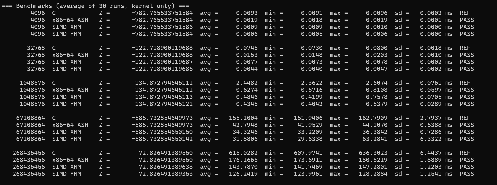

*Cache-size run, Debug.*

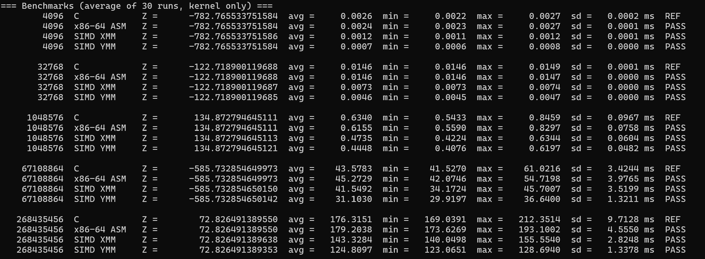

*Cache-size run, Release.*

## 9. Analysis (spec item viii; worth 20 points)

### 9.1 Which kernel is fastest?

**SIMD YMM is the fastest kernel in Release at every size**, followed by XMM, with C and scalar assembly tied for last. In Debug, YMM and XMM are effectively tied at 2^20 and 2^26 (their medians differ by less than their run-to-run range), and YMM is ahead at 2^28.

The biggest change between builds is the C kernel. In Debug it is about 3.6–4.0× slower than scalar assembly; in Release it matches scalar assembly almost exactly (0.99–1.00× at 2^20 and 2^28). The two kernels do the same work in the same order, and both produce bit-identical Z. The Debug gap therefore comes entirely from compiler overhead: without optimization, the compiler keeps the running sum in memory and loads and stores it on every iteration, while our assembly keeps it in a register. With optimization enabled, the compiler produces essentially the same scalar loop we wrote by hand.

Release C stays scalar: the compiler does not vectorize the loop on its own. Vectorizing would change the order of the floating-point additions, which MSVC does not do under its default floating-point model (it would need `/fp:fast`). This is why our SIMD kernels can still beat optimized C at all.

The assembly kernels are unaffected by the build configuration, since compiler settings cannot change hand-written assembly. For example, YMM at 2^28 takes 142 ms (Debug median) vs 125 ms (Release median), and 126 ms vs 125 ms in the single cache-size runs; the remaining gap is within the run-to-run variation.

### 9.2 Expected vs measured speedup

Ignoring memory, the expected speedup over scalar code equals the number of doubles processed per instruction:

| Kernel | Doubles per instruction | Expected vs scalar | Measured, in cache (2^15, Release) | Measured, large sizes (2^20–2^28, Release) |
| --- | ---: | ---: | ---: | ---: |
| XMM | 2 | 2x | 2.00x | 1.25–1.35x |
| YMM | 4 | 4x | 3.17x (3.43x at 2^12) | 1.42–1.44x |

When the data fits in cache, the measurements match theory: XMM is exactly twice as fast as scalar code, and YMM reaches 3.2–3.4× of its theoretical 4×. This shows the SIMD kernels are implemented correctly and can deliver their full width.

At the benchmark sizes required by the specification (2^20, 2^26, 2^28), the speedup collapses to about 1.3× for XMM and 1.4× for YMM, and it barely changes between those three sizes.

### 9.3 Why the speedup falls short: memory-bound or compute-bound?

**Work per element.** Each element needs two 8-byte loads (A[i] and B[i]) and only two floating-point operations (one multiply, one add). The loop reads 16 bytes for every 2 operations and never reuses any data, so it does very little arithmetic for each byte it must fetch.

**Data size vs cache size.** The test CPU has 8 MB of L3 cache, and each core can use only part of the 14 MB total L2.

| n | Data (A + B) | Where the data lives |
| --- | ---: | --- |
| 2^12 | 64 KiB | close to the L1 data cache |
| 2^15 | 512 KiB | fits in one core's L2 |
| 2^20 | 16 MiB | larger than L3: mostly streamed from RAM |
| 2^26 | 1 GiB | RAM |
| 2^28 | 4 GiB | RAM |

All three specification sizes are larger than the caches, which is why their speedups are nearly identical.

**The bandwidth ceiling.** Once data comes from RAM, every kernel runs into the same limit. In Release, scalar code reaches about 24–27 GB/s, XMM about 30–36 GB/s and YMM about 34–38 GB/s. Doubling the SIMD width from XMM to YMM gains only about 1.1–1.15×. In cache, the same YMM kernel reaches about 114 GB/s at 2^15, roughly three times its out-of-cache rate.

The machine's theoretical memory bandwidth is about 136 GB/s (8,533 MT/s × 16 bytes, assuming a 128-bit LPDDR5X memory bus), so our best single-threaded figure is about a quarter of it. This is expected for one core: a core can only have a limited number of cache-line requests in flight, and with a memory latency on the order of 100 ns, that caps how fast one core can pull data. Using the full bandwidth would require several cores working in parallel, which is outside this assignment.

**Why YMM still helps a little.** Fewer instructions per element leave the CPU more room to issue loads early, so it spends slightly less time waiting. But it is still waiting for memory most of the time, so the gain is small.

**What limits the in-cache case.** At 2^15, scalar code takes about 0.45 ns per element. Each iteration ends with an addition that must wait for the previous iteration's addition, because all elements are summed into one accumulator. XMM still performs one dependent addition per iteration but covers two elements, so it is exactly 2× faster; YMM covers four. YMM falls somewhat short of 4×, most likely because loading 64 bytes per iteration starts to limit it. Using several independent accumulators would shorten this dependency chain; we did not test this.

**Measurement noise.** On the test laptop, results varied by up to about 25% between uncontrolled runs, and even in controlled runs, single calls were occasionally 2–4× slower than the rest (for example, the Release 2^26 scalar-assembly outliers in Section 8.2). Because memory-bound kernels all hit the same bandwidth limit, small disturbances can reorder kernels whose times are close. We therefore treat differences smaller than the run-to-run range as ties.

### 9.4 AHAness answers

**Is this kernel memory-bound or compute-bound?** At the specification's sizes (2^20 and above), it is **memory-bound**. All kernels level off at a similar bandwidth of about 24–38 GB/s regardless of SIMD width, and wider SIMD gains only 1.3–1.4×. It becomes compute-bound only when the data fits in cache: at 2^15, XMM is exactly 2× and YMM about 3.2× faster than scalar code, close to their theoretical widths.

**Is SIMD YMM faster than optimized (Release) C?** **Yes, but only modestly at the specification's sizes:** about 1.42–1.44× at 2^20, 2^26 and 2^28 (Section 8.2). Inside the cache, the advantage grows to about 3.2–3.7×. Most of the dramatic speedups in the Debug table (up to about 5×) come from Debug C's overhead, not from SIMD.

## 10. Problems Encountered, Solutions, and AHA Moments (spec item ix)

<!--
Write from what actually happened. Possible prompts:
- The LNK2001 unresolved-external errors: cause, how you found it, fix.
- NASM setup (build customization vs custom build tool, PATH).
- Did 2^30 fail to allocate? What did you decide?
- Any correctness FAIL during development? What was the bug?
- What surprised you in the timings?
- What would you try next (e.g. multiple accumulators, FMA)?
-->

| # | Problem | Cause | Solution |
| --- | --- | --- | --- |
| 1 | Debug build failed with `LNK2001: unresolved external symbol` for all three assembly kernels | The Custom Build Tool for the `.asm` files was configured only for the **Release** configuration. In Debug they had no build rule, so they were silently skipped; the build log showed only the two `.c` files being compiled | Set the `.asm` files' Custom Build Tool properties with **Configuration: All Configurations** (and Platform: x64), then rebuilt; the log then showed each `.asm` file being assembled |
| 2 | Early timings couldn't be used | Development was partly on an Apple Silicon Mac, which can't run x86-64 AVX code natively, and early result tables didn't record the build type or machine | All final measurements on one x86-64 Windows laptop, with build type and hardware recorded |
| 3 | 2^30 failed to allocate | A and B together need 16 GB, the laptop's entire RAM | Reduced the largest size, as the specification allows |
| 4 | 2^30 later allocated but never finished, and 2^29 ran extremely slowly | `_aligned_malloc` reserves virtual memory, which Windows backed with the page file, so the program **thrashed** | Diagnosed with Task Manager (memory 97%, disk 95%, ~3.1 GB of 8 GB resident, CPU 5.8%); settled on 2^28 |
| 5 | Results that contradicted the code (YMM slower than XMM at 2^26; XMM no faster than scalar at 2^28) | Run-to-run variation of up to about 25% on the laptop; the anomalies disappeared on rerun | Fixed test conditions, 3 runs per build reported as the median; added min/max/sd to the output |
| 6 | Some averages inflated (e.g. Release 2^26 scalar ASM: 56 ms average vs ~43 ms typical) | A few of the 30 calls in a run were 2–4× slower than the rest | Detected through max and sd; flagged in the run log and footnoted in Section 8 instead of being reported as a real slowdown |
| 7 | Debug speedups looked dramatic (YMM ~5× faster than C) | Debug C stores the running sum in memory on every iteration; that's compiler overhead, not a SIMD benefit | Compared against Release C, where scalar ASM ≈ C and YMM is only ~1.4× faster |
| 8 | SIMD results never matched C exactly | SIMD adds in a different order (2 or 4 partial sums), and floating-point addition isn't associative | Compared with a tolerance scaled by sum of \|A[i]·B[i]\| instead of `==` |
| 9 | Initial boundary tests didn't match the checklist (only 1003 of 1000–1004) | The first test list covered the remainders but not the requested sizes | Added 1–8, 1000–1004 and 2^20+1…+3; left out n = 0 because `_aligned_malloc(0)` may return NULL |
| 10 | The specification's sizes couldn't show SIMD's theoretical speedup | All three are larger than the CPU caches, so every kernel was memory-bound | Added 2^12 and 2^15, which fit in cache: XMM reached exactly 2×, YMM ~3.2–3.4× |
| 11 | Tiny sizes are hard to time precisely | 2^12 kernels take under a microsecond, and times are printed to 0.1 µs | Used min alongside avg, and treated 2^15 as the main in-cache result |
| 12 | YMM kernel uses AVX instructions, not AVX2-specific ones | 256-bit packed-double multiply/add are part of AVX | [FILL: instructor's answer] |

[FILL: problems Persons 2 and 3 hit while writing the XMM/YMM kernels, e.g. tail handling, reduction, register saving]

**Lesson from problem 1:** in Visual Studio, project and file properties are stored per configuration, and the Properties dialog edits only the configuration selected at the top. A setting that works in Release can be missing in Debug and fail without a clear error. Checking the build log for what was actually compiled is what revealed it.

### 10.1 From free experimentation to a structured experiment

**Getting the build to work.** Our first full build failed at the linking stage with `LNK2001: unresolved external symbol` for all three assembly kernels. The C files compiled, but the build log showed no assembly step at all. The Custom Build Tool for the `.asm` files had only been set up for the Release configuration, so in Debug they were never passed to NASM. After applying the settings to all configurations, all four kernels linked. We also learned that development on an Apple Silicon Mac couldn't produce valid results, since it can't run x86-64 AVX code natively, so all final measurements were done on an x86-64 Windows laptop.

**First run (Debug).** All four kernels passed the correctness check, and the scalar assembly matched the C result exactly. 2^30 failed to allocate (2 × 8 GB). Two results didn't fit the rest:

- at 2^26, YMM was slower than XMM (60.7 vs 49.4 ms);
- at 2^28, XMM was no faster than scalar assembly (369.4 vs 369.5 ms).

Nothing in the code explained either result.

**The allocation that "succeeded".** After closing other programs and rerunning, the 2^30 allocation no longer failed, but the program never finished. We learned that `_aligned_malloc` reserves *virtual* memory, which Windows can back with the page file on the SSD. We then tried 2^29 (8 GB), which allocated but ran very slowly. Task Manager showed what was happening:

- system memory at 97% and disk at 95%;
- the program writing about 145 MB/s to disk, despite never opening a file;
- only about 3.1 GB of its 8 GB actually in RAM;
- only 5.8% CPU use.

The program was **thrashing**: spending its time moving memory pages between RAM and the SSD instead of computing. Any timings from that run would have measured the SSD, not memory. So we set 2^28 (4 GB) as our largest size, the biggest that fits in physical RAM, which the specification allows.

**The anomalies disappear.** A clean rerun at 2^20, 2^26 and 2^28 reversed both earlier anomalies: XMM and YMM were tied at 2^26 (49.9 vs 49.0 ms), and XMM clearly beat scalar assembly at 2^28. Comparing all the exploratory runs showed large run-to-run variation; C at 2^28, for example, measured 1504, 1207 and 1509 ms. We had been explaining results that were really measurement noise, which matters most at large n, where every kernel is limited by memory speed and small disturbances can change the ranking.

**Patterns that held in every run.**

- Every kernel passed, and scalar assembly always matched C exactly.
- At 2^20, the order was always YMM > XMM > scalar ASM > C.
- At 2^26 and 2^28, XMM and YMM levelled off at a similar bandwidth of about 20–24 GB/s.

**Moving to a structured experiment.** Because single runs couldn't be trusted, we added min, max and standard deviation to the program's output and adopted a fixed procedure for the final measurements (Section 3.3): fixed conditions, 3 consecutive runs per build, and the median reported with its range. The final results in Section 8 come from this procedure.

**Debug vs Release.** The controlled runs showed that the large Debug speedups were mostly compiler overhead. In Release, C became as fast as our scalar assembly, and YMM's advantage over C shrank from about 4.4–5.2× (Debug) to about 1.4× (Release).

**Testing inside the cache.** Since all three specification sizes are larger than the CPU caches, we added two sizes that fit (2^12 and 2^15). There, XMM was exactly 2× faster than scalar code and YMM about 3.2–3.4×, close to their theoretical widths. This confirmed that the kernels work as designed and that memory, not the SIMD code, limits them at large sizes.

### 10.2 AHA moments

- **A successful allocation doesn't mean the data fits in RAM.** Virtual memory can hide the problem until the program slows to disk speed.
- **Wider SIMD only pays off when the data is close to the CPU.** In cache, YMM was 3.2–3.4× faster than scalar code; out of cache, only about 1.4×, because every kernel waits on memory.
- **The compiler's optimizer mattered more than SIMD at large sizes.** Going from Debug to Release made C about 4× faster; hand-written YMM added only about 1.4× on top of that.
- **Measurement noise can look like a real result.** Two "anomalies" from our first runs disappeared on rerun; only repeated, controlled runs showed which differences were real.

## 11. How to Build and Run

**Prerequisites**

- Windows 10/11 on an x86-64 CPU with AVX support (required for the XMM/YMM kernels)
- Visual Studio with the *Desktop development with C++* workload
- NASM, with its install folder added to `PATH` (check with `nasm -v`)

**Steps**

1. Clone the repository and open the solution file in Visual Studio.
2. Set the platform to **x64** and the configuration to **Debug** or **Release**.
3. Build with **Build → Rebuild Solution**. The `.asm` files are assembled with `nasm -f win64`.
4. Run with **Debug → Start Without Debugging** (Ctrl+F5).
5. The console prints the boundary tests first, then the timed benchmarks with PASS/FAIL for each kernel, and finally a correctness report grouped by kernel.

## Appendix: Controlled-run screenshots

The benchmark sections of the six controlled runs used for the tables in Sections 8.1 and 8.2.

### Debug

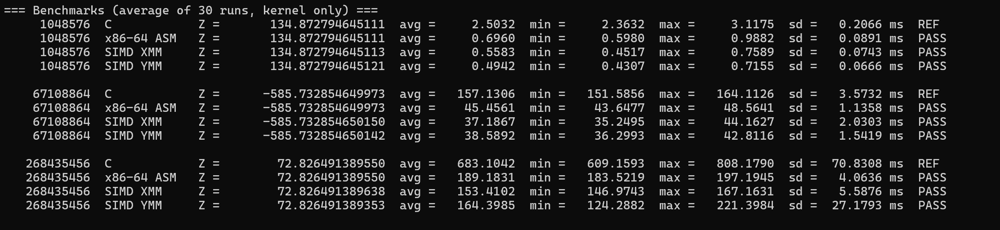

*Debug run 1.*

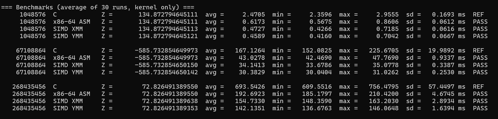

*Debug run 2.*

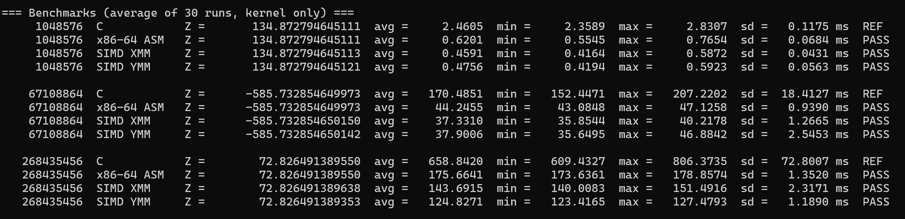

*Debug run 3.*

### Release

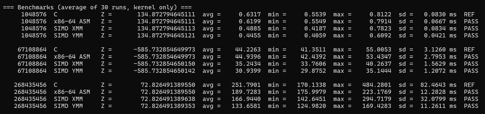

*Release run 1.*

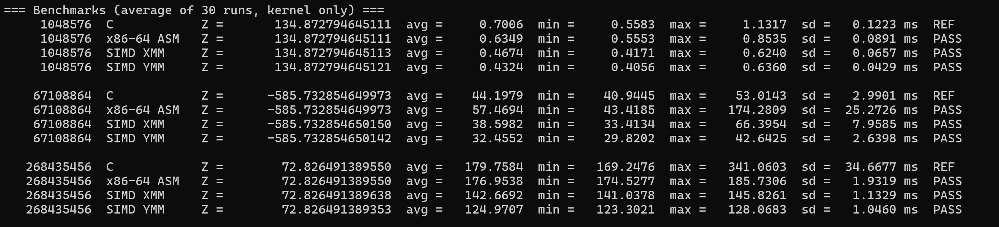

*Release run 2.*

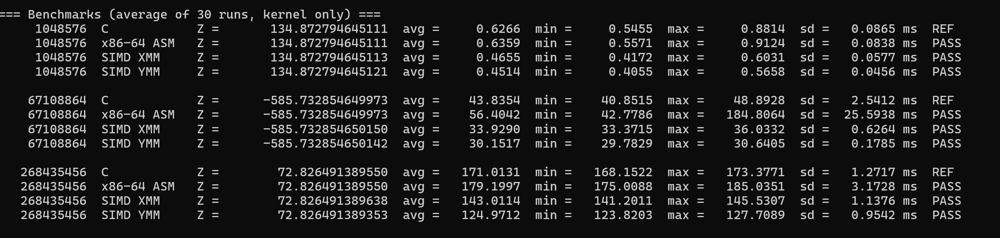

*Release run 3.*